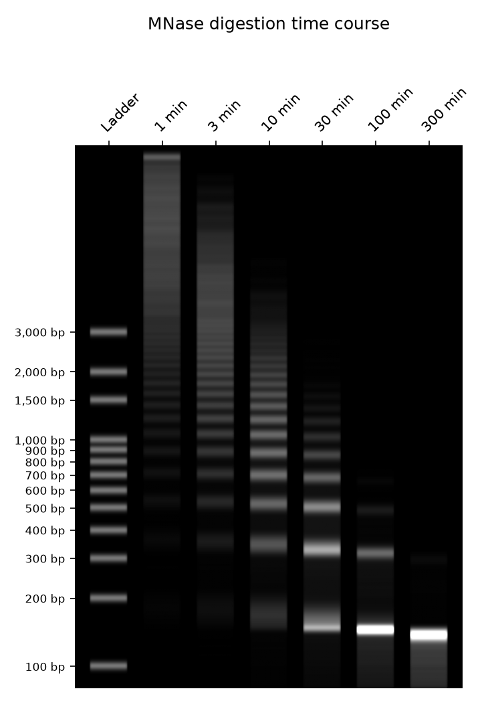

# Micrococcal Nuclease Simulation

This repository contains a Monte Carlo simulation of Micrococcal Nuclease (MNase) digesting chromatin that still carries its nucleosomes. It renders the result as an agarose gel time course: the classic nucleosome ladder (mono-, di-, tri-nucleosomes…) that collapses toward the ~147 bp core particle as digestion proceeds.



## Model

- **Chromatin template** (`src/chromatin.py`): independent DNA molecules, each laid out as `linker – core – linker – … – core – linker`. Linker lengths are drawn from a normal distribution (`linker_sd=0` gives a perfectly regular array), and any linker can optionally be replaced by a nucleosome-free region.
- **Digestion** (`src/digest.py`): a tau-leaping Monte Carlo over time steps `dt`. Each step:
  1. **Endonuclease cuts** form a Poisson process whose rate per bp is `k_linker` in linkers and `k_nuc` (≪ `k_linker`) inside cores.
  2. **Exonuclease trimming**: every free end is nibbled inward at `k_exo_linker` bp/min in linker DNA. Ends stall at nucleosome borders and then eat into the core at `k_exo_nuc`.
  3. Fragments shorter than `min_len` are lost as acid-soluble material.

  Lanes are aliquots taken from the same digestion at successive times.
- **Gel** (`src/gel.py`): migration is log-linear in bp, and DNA above ~20 kb sits in the compression zone under the well. Band intensity is proportional to DNA mass (EtBr/SYBR staining), blurred with a Gaussian band width and shown next to a 100 bp ladder.

## Usage

```bash
pip install -r requirements.txt
python main.py --seed 1 --out gel.png
python main.py --help   # template, kinetics and run options
```

Useful knobs:
- `--linker-mean` / `--linker-sd` set the nucleosome repeat length and how much the higher-order bands blur.
- `--k-nuc` controls over-digestion into sub-nucleosomal fragments.
- `--time` sets a lane sample time; repeat it once per lane (e.g. `--time 1 --time 10 --time 100`).
- `--style inverted` gives dark bands on white.

## Tests

```bash
pytest
```
